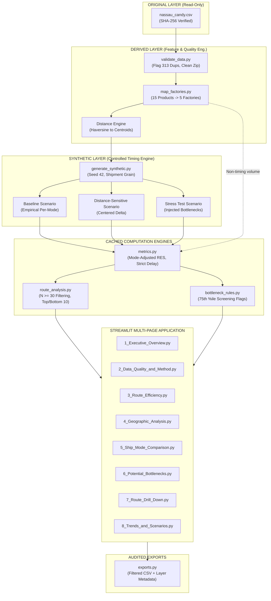
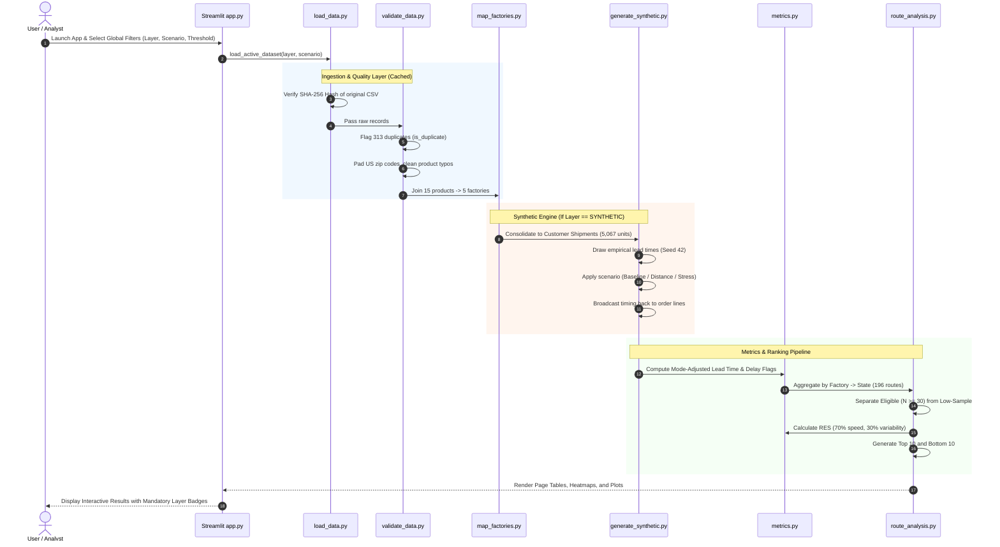
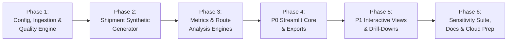

# Nassau Candy Shipping Route Intelligence
## Technical Architecture Specification (ARCHITECTURE.md)

| Document Metadata | Specification |
|---|---|
| **Project** | Nassau Candy Shipping Route Intelligence |
| **Document Version** | 1.0 (Draft for Approval) |
| **Status** | Pending User Sign-Off |
| **Author** | System Architecture Agent (Winston) |
| **Baseline Authority** | `docs/Nassau_Route_Intelligence_PRD_v1.3_FINAL.md` & `docs/DATA_AUDIT.md` |
| **Approved Stack** | Python 3.11+, Pandas, NumPy, Streamlit, Plotly, openpyxl, pytest |
| **Primary Invariant** | Strict three-tier data separation (`ORIGINAL`, `DERIVED`, `SYNTHETIC`) with read-only source immutability |

---

## 1. Architecture Overview & Core Paradigm

The **Nassau Candy Shipping Route Intelligence** system is architected as an **auditable, layered decision-support data pipeline** powering an interactive Streamlit analytical application.



### Architectural Tenets
1. **Source Immutability:** The raw file (`data/original/nassau_candy.csv`) is read-only. Ingestion verifies its SHA-256 hash (`6ae9208e...`) at startup.
2. **Explicit Layer Isolation:** Analytical components and UI visualizations operate against a single declared layer (`ORIGINAL`, `DERIVED`, or `SYNTHETIC`). Blending or silent fallback is prohibited.
3. **No Automatic Date Invention:** The massive raw lead-time anomaly (904–1,642 days) is documented as an unconfirmed export artifact. The diagnostic floor reconstruction (0–11 days) is isolated exclusively as a calibration aid on the Data Quality page and is never labeled as actual company performance.
4. **Shipment-Grain Timing Consistency:** Synthetic timing is generated at the customer shipment level (`Customer ID` + `Order Date` + `Ship Mode`), ensuring that order lines split across multiple factories share consistent dispatch timing.
5. **Mode-Mix Normalization:** Route comparisons use **Mode-Adjusted RES** by default to prevent routes with higher Standard Class utilization from being penalized by ship-mode mix alone.

---

## 2. Invariant Architecture Decisions (ADs)

### AD-01: Source Dataset Read-Only Immutability
* **Binds:** `src/load_data.py`.
* **Prevents:** Accidental overwrites, silent in-place transformations, data drift.
* **Rule:** The dataset is read directly into memory. File write operations to `data/original/` are strictly blocked. Ingestion checks that SHA-256 equals `6ae9208e77ce410e90073b19813d29f89853ce9f3cce43d41f9643781696e94f`. Any mismatch halts startup.

### AD-02: Strict Three-Tier Layer Separation
* **Binds:** Entire data model, caching mechanisms, UI layer indicators.
* **Prevents:** Misrepresenting synthetic demonstration figures as real historical performance.
* **Rule:** Every dataframe and exported artifact contains a required `data_layer` categorical column (`ORIGINAL`, `DERIVED`, `SYNTHETIC`). Every chart and table renders an explicit badge:
  * `ORIGINAL — SOURCE DATA`
  * `DERIVED — CALCULATED FROM SOURCE`
  * `SYNTHETIC — NOT ACTUAL PERFORMANCE`

### AD-03: Preservation of Date Values and Diagnostic Isolation
* **Binds:** `src/load_data.py`, `src/validate_data.py`.
* **Prevents:** Arbitrary offsets being baked into raw data.
* **Rule:** Original `Order Date` and `Ship Date` are preserved verbatim as `Order_Date_Original` and `Ship_Date_Original`. Raw intervals (`Ship Date − Order Date`) are retained. The floor subtraction hypothesis (subtracting 904, 1,269, 1,269, 1,634 days by Order-ID year) is calculated only as a diagnostic feature (`lead_time_reconstructed_diagnostic`) for Data Quality audits and baseline calibration.

### AD-04: Multi-Factory Shipment Grouping & Hierarchical Grain
* **Binds:** `src/validate_data.py`, `src/generate_synthetic.py`, `src/metrics.py`.
* **Prevents:** Miscounting multi-factory customer orders and inconsistent dispatch dates across bundle legs.
* **Rule:** The system enforces three distinct analytical grains:
  1. **Line Item (10,194 rows):** Base table row; used for revenue, units, and manufacturing profit.
  2. **Order Line (8,549 distinct `Order ID`s):** Primary unit for route volume, delay frequency, and RES. An Order ID contains exactly one factory by design.
  3. **Customer Shipment (`Customer ID` + `Order Date` + `Ship Mode` = 5,067 shipments):** Consolidation grain for generating synthetic dispatch dates. All order lines belonging to the same customer shipment receive identical generated dispatch timing.

### AD-05: Reproducible Synthetic Generation Engine
* **Binds:** `src/generate_synthetic.py`, `config/generator.yaml`.
* **Prevents:** Non-deterministic demonstration runs and circular machine-learning claims.
* **Rule:** Generation uses NumPy random generator with fixed seed `42`. Three scenarios are supported:
  * **Baseline (Default):** Draws lead times from the empirical per-mode distribution (PRD Appendix D: Same Day 0.38d, First Class 2.55d, Second Class 3.57d, Standard 5.32d). No route or distance effects.
  * **Distance-Sensitive:** Baseline + $0.5 \times (\text{Distance\_km} - \mu_{\text{dist}}) / 1000$ days (centered to preserve mode means).
  * **Stress Test:** Injected delays (+1.0d in Nov/Dec, +1.0d in top-2 volume states CA/NY, +1.5d on top-2 high-volume routes).
  * *Constraint:* Values bounded in $[0, 2]$ for Same Day, $[1, 14]$ for other modes. Re-runs must match hash.

### AD-06: Route Efficiency Score (RES) & Mode-Adjustment Formulation
* **Binds:** `src/metrics.py`, `src/route_analysis.py`.
* **Prevents:** Rewarding routes solely because they ship via First Class/Same Day.
* **Rule:**
  $$\text{LeadTime}_{\text{mode\_adj}} = \text{LeadTime} - \mu_{\text{ship\_mode}}$$
  $$\text{SpeedPenalty} = \text{MinMaxNormalize}(\mu_{\text{route\_lead\_time}})$$
  $$\text{VariabilityPenalty} = \text{MinMaxNormalize}(\sigma_{\text{route\_lead\_time}})$$
  $$\text{RES} = 100 \times [1 - (0.70 \times \text{SpeedPenalty} + 0.30 \times \text{VariabilityPenalty})]$$
  * Default lead-time basis is **Mode-Adjusted**. A raw score basis and a speed-only score ($100/0$) are calculated and displayed side-by-side.

### AD-07: Minimum Sample Guardrail ($N \ge 30$)
* **Binds:** `src/route_analysis.py`.
* **Prevents:** Small-sample ranking instability (e.g., Sugar Shack with 33 total orders across all states).
* **Rule:** State-level routes (`Factory → State`) require $N \ge 30$ order lines to appear in Top 10 / Bottom 10 leaderboards. Routes with $N < 30$ are routed to a "Low Sample / Insufficient Data" table. Small factories (`Sugar Shack`, `Secret Factory`, `The Other Factory`) are aggregated to `Factory → Customer Region`.

### AD-08: Privacy Protection and Public Deployment Restrictions
* **Binds:** `app.py`, `src/exports.py`.
* **Prevents:** Exposure of proprietary source data or customer accounts.
* **Rule:** When deployed to Streamlit Community Cloud:
  1. The UI restricts data selection to the `SYNTHETIC` layer.
  2. `Customer ID` is hashed with SHA-256 or masked.
  3. The `ORIGINAL` layer is accessible only in authenticated or local development modes.

### AD-09: Strict Delay Boundary Evaluation
* **Binds:** `src/metrics.py`.
* **Prevents:** Boundary discrepancies across dashboard pages.
* **Rule:** A record is delayed if and only if $\text{lead\_time\_days} > \text{threshold}$ (strict inequality). $\text{lead\_time} = \text{threshold}$ is strictly on-time.

---

## 3. Project Directory Structure

```text
factory/
├── config/
│   ├── factories.csv               # Factory coordinates (lat/long) and addresses
│   ├── product_factory.csv         # 15-product to 5-factory mapping
│   ├── state_centroids.csv         # US state centroid coordinates for distance calc
│   └── generator.yaml              # Synthetic calibration params, seed 42, empirical tables
├── data/
│   ├── original/
│   │   └── nassau_candy.csv        # Immutable raw source file (SHA-256 verified)
│   ├── derived/
│   │   ├── clean_orders.parquet    # Cleaned, mapped, postal-padded dataset
│   │   └── route_aggregates.parquet# Pre-aggregated Factory -> State & Region tables
│   └── synthetic/
│       ├── baseline.parquet        # Baseline scenario synthetic dataset
│       ├── distance_sensitive.parquet # Distance-sensitive scenario
│       ├── stress_test.parquet     # Stress-test scenario with injected delays
│       └── metadata.json           # Generation seed, run timestamp, scenario parameters
├── docs/
│   ├── Nassau_Route_Intelligence_PRD_v1.3_FINAL.md # Approved PRD
│   ├── DATA_AUDIT.md               # Source dataset audit report
│   ├── ARCHITECTURE.md             # This document
│   ├── data_dictionary.md          # Formal column definitions and semantic units
│   ├── methodology.md              # Research paper methodology and formulas
│   └── synthetic_assumptions.md    # Disclosed generator rules and bounds
├── src/
│   ├── __init__.py
│   ├── config.py                   # Centralized configuration, paths, defaults, weights
│   ├── load_data.py                # Hash verification, read-only ingestion, schema validation
│   ├── validate_data.py            # Data quality checks, duplicate flags, postal code padding
│   ├── map_factories.py            # Product-to-factory joins, coordinate attachment, haversine
│   ├── generate_synthetic.py       # Shipment-grain synthetic timing generator (Seed 42)
│   ├── metrics.py                  # Lead time, mode-adjusted residuals, RES math, delay rates
│   ├── route_analysis.py           # Route aggregation, N >= 30 filtering, Top/Bottom 10
│   ├── bottleneck_rules.py         # 75th percentile screening flags and watch list quadrant
│   └── exports.py                  # Filtered CSV generator with embedded metadata
├── tests/
│   ├── conftest.py                 # Pytest fixtures and sample dataframes
│   ├── test_data_quality.py        # Tests for hash, duplicates, date diagnostics, zip codes
│   ├── test_mapping.py             # Tests for 15/15 product coverage, factory coords, distance
│   ├── test_synthetic.py           # Tests for seed 42 reproducibility, bounds, calibration
│   ├── test_metrics.py             # Tests for RES math [0, 100], mode-adjustment, strict delay
│   ├── test_route_analysis.py      # Tests for N >= 30 rules, small factory rollups, ranking
│   ├── test_bottlenecks.py         # Tests for quadrant detection and stress-test recovery
│   └── test_exports.py             # Tests for export metadata, headers, layer tagging
├── app.py                          # Streamlit application entrypoint & global sidebar filters
├── pages/
│   ├── 1_Executive_Overview.py     # High-level KPIs, volume vs lines, business insights
│   ├── 2_Data_Quality_and_Method.py# Audit dashboard, duplicate table, date diagnostic
│   ├── 3_Route_Efficiency.py       # RES leaderboard, Top/Bottom 10, mode-adjusted vs raw
│   ├── 4_Geographic_Analysis.py    # Plotly US choropleth heatmap, metric picker
│   ├── 5_Ship_Mode_Comparison.py   # Standard vs Expedited, distance bands, COGS margin
│   ├── 6_Potential_Bottlenecks.py  # Volume vs Delay quadrant, screening flags
│   ├── 7_Route_Drill_Down.py       # Route/state explorer, order timelines
│   └── 8_Trends_and_Scenarios.py   # Monthly trends, Baseline vs Stress comparison
├── pyproject.toml                  # Python build & dependency metadata
└── requirements.txt                # Pinned production dependencies
```

---

## 4. Detailed Module Responsibilities

### `src/config.py`
* **Purpose:** Single source of truth for runtime constants, paths, and algorithmic defaults.
* **Exports:**
  * File paths (`DATA_ORIGINAL_PATH`, `CONFIG_DIR`, `DERIVED_DIR`, `SYNTHETIC_DIR`).
  * Expected source hash: `6ae9208e77ce410e90073b19813d29f89853ce9f3cce43d41f9643781696e94f`.
  * Default parameters: `DEFAULT_SEED = 42`, `DEFAULT_DELAY_THRESHOLD = 5`, `DEFAULT_MIN_SAMPLE = 30`, `DEFAULT_SPEED_WEIGHT = 0.70`, `DEFAULT_VARIABILITY_WEIGHT = 0.30`.
  * Layer enums: `LayerEnum.ORIGINAL`, `LayerEnum.DERIVED`, `LayerEnum.SYNTHETIC`.

### `src/load_data.py`
* **Purpose:** Secure, read-only ingestion and schema enforcement.
* **Key Functions:**
  * `verify_source_integrity(filepath: Path) -> bool`: Computes SHA-256 and asserts match.
  * `load_original_csv(filepath: Path) -> pd.DataFrame`: Reads CSV into Pandas with explicit dtypes (`Order ID`: string, `Postal Code`: string, dates parsed as `dd-mm-yyyy`).
  * `load_active_dataset(layer: LayerEnum, scenario: str) -> pd.DataFrame`: Caching loader that returns the appropriate layer.

### `src/validate_data.py` (Data-Quality Investigation Module)
* **Purpose:** Automated audit, anomaly detection, and non-destructive cleaning flags.
* **Key Functions:**
  * `audit_dataset(df: pd.DataFrame) -> dict`: Produces summary metrics (10,194 rows, null counts, distinct Order IDs, date ranges).
  * `flag_duplicates(df: pd.DataFrame) -> pd.DataFrame`: Evaluates exact duplicates across all columns excluding `Row ID`. Adds boolean column `is_duplicate`.
  * `clean_geographic_fields(df: pd.DataFrame) -> pd.DataFrame`: Pads 4-digit US postal codes with leading `0`; flags Canadian codes as `is_partial_postal = True`.
  * `normalize_product_names(df: pd.DataFrame) -> pd.DataFrame`: Fixes `Wonka Bar -Scrumdiddlyumptious` spacing.
  * `compute_diagnostic_reconstruction(df: pd.DataFrame) -> pd.DataFrame`: Extracts Order-ID year, applies floor subtraction (904/1,269/1,269/1,634), and generates `lead_time_reconstructed_diagnostic` labeled as hypothesis.

### `src/map_factories.py`
* **Purpose:** Product-to-factory relational resolution and geographic distance modeling.
* **Key Functions:**
  * `attach_factories(df: pd.DataFrame, mapping_df: pd.DataFrame) -> pd.DataFrame`: Joins product to factory (15 products $\rightarrow$ 5 factories). Asserts zero unmatched rows.
  * `calculate_distances(df: pd.DataFrame, centroids_df: pd.DataFrame) -> pd.DataFrame`: Uses Haversine formula to compute great-circle distance (km) from factory coordinates to destination state centroids.

### `src/generate_synthetic.py`
* **Purpose:** Controlled, shipment-grain synthetic lead-time engine.
* **Key Functions:**
  * `group_into_customer_shipments(df: pd.DataFrame) -> pd.DataFrame`: Groups by `(Customer ID, Order Date, Ship Mode)`.
  * `generate_lead_times(shipments: pd.DataFrame, scenario: str, seed: int = 42) -> pd.DataFrame`:
    * Draws base lead times from empirical distributions in `config/generator.yaml`.
    * Applies scenario adjustments (Distance centering or Stress-test injections).
    * Enforces boundary caps ($[0, 2]$ for Same Day; $[1, 14]$ for others).
  * `merge_synthetic_timing(orders_df: pd.DataFrame, synthetic_shipments: pd.DataFrame) -> pd.DataFrame`: Broadcasts shipment lead time across all constituent order lines. Computes `Ship_Date_Synthetic = Order_Date + Lead_Time_Days`.

### `src/metrics.py`
* **Purpose:** Lead-time residual modeling, RES scoring, and delay frequency.
* **Key Functions:**
  * `calculate_mode_adjusted_lead_time(df: pd.DataFrame) -> pd.DataFrame`: Subtracts ship-mode reference mean from lead time.
  * `calculate_route_efficiency_score(route_stats: pd.DataFrame, basis: str = "mode_adjusted", w_speed: float = 0.7, w_var: float = 0.3) -> pd.DataFrame`:
    * Min-max normalizes speed and variability penalties across eligible routes.
    * Computes RES $[0, 100]$ and speed-only score ($100/0$).
    * Handles zero-variance edge cases (penalty = 0 if $\max = \min$).
  * `apply_delay_threshold(df: pd.DataFrame, threshold_days: int) -> pd.DataFrame`: Sets boolean `is_delayed = lead_time_days > threshold_days`.

### `src/route_analysis.py`
* **Purpose:** Route aggregations, threshold filtering, and leaderboard generation.
* **Key Functions:**
  * `aggregate_routes(df: pd.DataFrame, level: str = "state") -> pd.DataFrame`: Aggregates order lines by `(Factory, State)` or `(Factory, Region)`. Computes counts, means, medians, standard deviations, and delay rates.
  * `filter_eligible_routes(route_df: pd.DataFrame, min_sample: int = 30) -> tuple[pd.DataFrame, pd.DataFrame]`: Splits routes into eligible ($N \ge 30$) and low-sample ($N < 30$).
  * `generate_leaderboards(eligible_df: pd.DataFrame) -> tuple[pd.DataFrame, pd.DataFrame]`: Returns Top 10 and Bottom 10 routes sorted by RES.

### `src/bottleneck_rules.py`
* **Purpose:** Transparent quadrant screening rules.
* **Key Functions:**
  * `flag_bottlenecks(df: pd.DataFrame, vol_pct: float = 0.75, delay_pct: float = 0.75) -> pd.DataFrame`:
    * Assigns `is_bottleneck = (volume >= P75) & (delay_rate >= P75)`.
    * Assigns `is_watchlist = (volume >= P75) & (delay_rate > Median) & (~is_bottleneck)`.

### `src/exports.py`
* **Purpose:** Audited CSV export formatting.
* **Key Functions:**
  * `create_export_csv(df: pd.DataFrame, metadata: dict) -> bytes`: Generates CSV with prepended comment header documenting data layer, scenario, active filter values, delay threshold, and timestamp.

---

## 5. End-to-End Data Flow



---

## 6. Testing Strategy & Quality Gates

The testing framework uses `pytest` with 100% automated coverage of critical paths:

| Test Suite | Test Target | Verification Check |
|---|---|---|
| `test_data_quality.py` | Hash Verification | Assert SHA-256 matches `6ae9208e...` before and after test execution. |
| | Row Reconciliation | Assert total rows $= 10,194$; clean unique $= 9,881$; duplicate extra copies $= 313$. |
| | Date Anomaly Audit | Assert 100% of raw intervals $> 30$ days; 0 negative intervals; 0 parse errors. |
| | Postal Code Padding | Assert all US postal codes are 5-character strings; Canadian codes flagged as partial. |
| `test_mapping.py` | Factory Joins | Assert 15/15 products match factory table; 0 unmapped rows. |
| | Distance Calculation | Assert Haversine distance matches benchmark coordinates within $\pm 1\%$. |
| `test_synthetic.py` | Seed Reproducibility | Running generator twice with seed 42 yields identical SHA-256 dataframe hash. |
| | Bounds Enforcement | Assert Same Day in $[0, 2]$; others in $[1, 14]$; 0 negative values. |
| | Calibration Validation | Assert Baseline means match targets (Same Day: 0.38d, First: 2.55d, Second: 3.57d, Standard: 5.32d $\pm 0.10$). |
| `test_metrics.py` | RES Math & Bounds | Assert RES bounded in $[0, 100]$; hand-computed test vector matches to 4 decimal places. |
| | Mode Adjustment | Assert mean mode-adjusted residual is $0.0 \pm 10^{-6}$ within each ship mode. |
| | Strict Delay Boundary | Assert `lead_time == threshold` is NOT delayed; `lead_time == threshold + 1` IS delayed. |
| `test_route_analysis.py` | Sample Guardrails | Assert routes with $N < 30$ never appear in Top 10 / Bottom 10. |
| | Regional Rollup | Assert Sugar Shack, Secret Factory, and The Other Factory roll up to region level. |
| `test_bottlenecks.py` | Screening Recovery | Assert known injected delays in Stress Test scenario are recovered by P75 quadrant rules. |
| `test_exports.py` | Provenance Audit | Assert exported CSV contains metadata header with layer badge, filters, and timestamp. |

---

## 7. Implementation Sequence

The build proceeds in **6 disciplined, test-driven phases**:



1. **Phase 1: Config, Ingestion & Quality Engine (P0 Foundation)**
   * Create `config/` tables (`factories.csv`, `product_factory.csv`, `state_centroids.csv`, `generator.yaml`).
   * Implement `src/config.py`, `src/load_data.py`, and `src/validate_data.py`.
   * Pass `test_data_quality.py` and `test_mapping.py`.
2. **Phase 2: Shipment-Grain Synthetic Generator (P0 Foundation)**
   * Implement `src/generate_synthetic.py` with multi-factory shipment grouping.
   * Implement Baseline, Distance-Sensitive, and Stress-Test scenarios (Seed 42).
   * Pass `test_synthetic.py` calibration and hash stability checks.
3. **Phase 3: Metrics, Scoring & Route Engines (P0 Foundation)**
   * Implement `src/metrics.py`, `src/route_analysis.py`, and `src/bottleneck_rules.py`.
   * Implement Mode-Adjusted RES, sample size filtering ($N \ge 30$), and quadrant logic.
   * Pass `test_metrics.py`, `test_route_analysis.py`, and `test_bottlenecks.py`.
4. **Phase 4: Core Streamlit Dashboard & Exports (P0 Deliverables)**
   * Build `app.py` shell, global filter state management, and layer banners.
   * Build P0 pages: *2_Data_Quality_and_Method.py*, *1_Executive_Overview.py*, *3_Route_Efficiency.py*.
   * Build `src/exports.py` and pass `test_exports.py`.
5. **Phase 5: Interactive Visualizations & Deep Dives (P1 Features)**
   * Build *4_Geographic_Analysis.py* (Plotly US choropleth with Canada exclusion note).
   * Build *5_Ship_Mode_Comparison.py* (Standard vs Expedited, distance bands, product margin).
   * Build *6_Potential_Bottlenecks.py* (Interactive quadrant scatter).
   * Build *7_Route_Drill_Down.py* (Order-to-ship timeline visualizer).
   * Build *8_Trends_and_Scenarios.py* (Monthly trends, scenario comparison).
6. **Phase 6: Sensitivity Verification, Documentation & Deployment**
   * Run weight sensitivity experiments (50/50, 70/30, 90/10) and seed robustness checks.
   * Generate publication figures for research paper via Matplotlib/Seaborn.
   * Finalize `docs/data_dictionary.md`, `docs/methodology.md`, and `docs/synthetic_assumptions.md`.
   * Prepare Streamlit Community Cloud deployment (Synthetic layer only, customer ID hashed).
