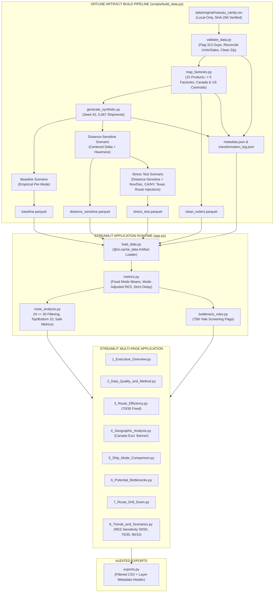
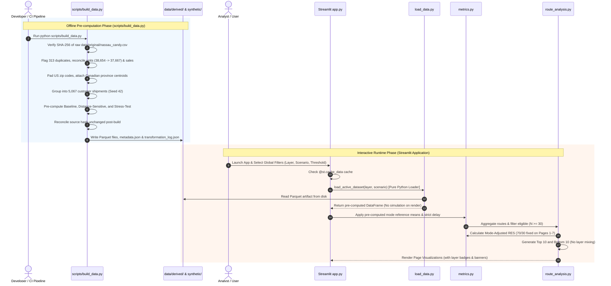

# Nassau Candy Shipping Route Intelligence
## Technical Architecture Specification (ARCHITECTURE.md)

| Document Metadata | Specification |
|---|---|
| **Project** | Nassau Candy Shipping Route Intelligence |
| **Document Version** | 1.1 (Implementation Baseline) |
| **Status** | Implementation Baseline v1.1 (Aligned with PRD v1.3 & Technical Review) |
| **Author** | System Architecture Agent (Winston) |
| **Baseline Authority** | `docs/Nassau_Route_Intelligence_PRD_v1.3_FINAL.md` & `docs/DATA_AUDIT.md` |
| **Approved Stack** | Python 3.11+, Pandas, NumPy, Streamlit, Plotly, openpyxl, pytest, PyYAML, pyarrow, matplotlib, seaborn |
| **Storage Standard** | Apache Parquet (via pyarrow) for high-performance artifacts; CSV for audited tabular exports |
| **Primary Invariant** | Strict three-tier data separation (`ORIGINAL`, `DERIVED`, `SYNTHETIC`) with read-only source immutability |

---

## 1. Architecture Overview & Core Paradigm

The **Nassau Candy Shipping Route Intelligence** system is architected as an **offline-prepared, auditable data pipeline** powering an interactive Streamlit analytical application.



### Architectural Tenets
1. **Source Immutability & Dual-Mode Integrity:** 
   * *Local Mode:* Ingestion verifies the raw source file (`data/original/nassau_candy.csv`) against SHA-256 (`6ae9208e...`) at startup. The raw file is strictly read-only and never modified or overwritten. Access to the `ORIGINAL` layer is local-only.
   * *Cloud Mode:* Streamlit Community Cloud deployments operate entirely from validated derived/synthetic Parquet artifacts and `metadata.json`. Cloud mode does not fail if `data/original/` is absent.
2. **Offline Pre-computed Artifacts:** Data artifacts are built and validated ahead of runtime via `scripts/build_data.py`. The Streamlit application strictly loads and caches prepared artifacts via `@st.cache_data`; it never executes heavy simulations or re-generates datasets during page rendering.
3. **Explicit Layer Isolation:** Analytical components and UI visualizations operate against a single declared layer (`ORIGINAL`, `DERIVED`, or `SYNTHETIC`). Blending or silent fallback is prohibited across all leaderboards and charts.
4. **No Automatic Date Invention:** The massive raw lead-time anomaly (904–1,642 days) is documented as an unconfirmed export artifact. The diagnostic floor reconstruction (0–11 days) is isolated exclusively as an audit calibration aid on Page 2 (*Data Quality & Method*) and is never labeled as actual company performance.
5. **Shipment-Grain Timing Consistency:** Synthetic timing is generated at the customer shipment level (`Customer ID` + `Order Date` + `Ship Mode`), ensuring that order lines split across multiple factories share consistent dispatch timing.
6. **Pre-computed Mode-Mix Reference Means:** Shipping-mode reference means $\mu_{\text{ship\_mode}}$ are pre-computed on the full applicable scenario dataset before user filters are applied. User filters must not mutate the reference means used for RES calculations.
7. **No Authentication Required:** The application requires no user authentication. Environment gating (local vs cloud) is achieved solely by artifact presence and configuration flags.

---

## 2. Invariant Architecture Decisions (ADs)

### AD-01: Source Dataset Read-Only Immutability & Dual-Mode Ingestion
* **Binds:** `src/load_data.py`, `scripts/build_data.py`.
* **Prevents:** Accidental overwrites, silent in-place transformations, data drift, and cloud startup failures.
* **Rule:** 
  1. The raw dataset (`data/original/nassau_candy.csv`) is strictly read-only and never modified or overwritten by any script or application process.
  2. *Local Mode:* When `data/original/nassau_candy.csv` is present, ingestion checks that its SHA-256 hash equals `6ae9208e77ce410e90073b19813d29f89853ce9f3cce43d41f9643781696e94f`. Any mismatch halts processing. Access to the `ORIGINAL` layer is local-only.
  3. *Cloud Deployment Mode:* The application operates strictly from validated Parquet artifacts (`data/derived/` and `data/synthetic/`) and `metadata.json`. It does not fail or halt because the original source file is absent. Raw source data is never committed to version control.

### AD-02: Strict Three-Tier Layer Separation
* **Binds:** Entire data model, caching mechanisms, UI layer indicators.
* **Prevents:** Misrepresenting synthetic demonstration figures as real historical performance.
* **Rule:** Every dataframe and exported artifact contains a required `data_layer` categorical column (`ORIGINAL`, `DERIVED`, `SYNTHETIC`). Every chart and table renders an explicit badge:
  * `ORIGINAL — SOURCE DATA`
  * `DERIVED — CALCULATED FROM SOURCE`
  * `SYNTHETIC — NOT ACTUAL PERFORMANCE`

### AD-03: Preservation of Date Values and Diagnostic Isolation
* **Binds:** `src/load_data.py`, `src/validate_data.py`, `pages/2_Data_Quality_and_Method.py`.
* **Prevents:** Arbitrary offsets being baked into raw data or unverified diagnostic hypotheses leaking into operational analytics.
* **Rule:** Original `Order Date` and `Ship Date` are preserved verbatim as `Order_Date_Original` and `Ship_Date_Original`. Raw intervals (`Ship Date − Order Date`) are retained. The floor subtraction hypothesis (subtracting 904, 1,269, 1,269, 1,634 days by Order-ID year) is calculated only as a diagnostic feature (`lead_time_reconstructed_diagnostic`). **Quarantine Decision (Option A):** Reconstructed diagnostic timing is strictly isolated to Page 2 (*Data Quality & Method*) for calibration and audit analysis. It is never permitted on operational or route drill-down pages and is never presented as actual company shipping performance.

### AD-04: Multi-Factory Shipment Grouping & Hierarchical Grain
* **Binds:** `src/validate_data.py`, `src/generate_synthetic.py`, `src/metrics.py`.
* **Prevents:** Miscounting multi-factory customer orders and inconsistent dispatch dates across bundle legs.
* **Rule:** The system enforces three distinct analytical grains and verified counts:
  1. **Line Item (10,194 raw rows $\rightarrow$ 9,881 unique rows):** Base table row; used for revenue, units, and manufacturing profit.
  2. **Order Line (8,549 distinct `Order ID`s):** Primary unit for route volume, delay frequency, and RES. An Order ID contains exactly one factory by design.
  3. **Customer Shipment (`Customer ID` + `Order Date` + `Ship Mode` = 5,067 shipments):** Consolidation grain for generating synthetic dispatch dates. All order lines belonging to the same customer shipment receive identical generated dispatch timing.
     * *Multi-Factory Shipments:* 1,702 shipments (33.6%) contain products originating from two or more factories.
     * *Multi-Order-Line Shipments:* 2,240 shipments contain two or more distinct Order IDs.
     * Shipment counts (5,067) are strictly distinguished from order-line counts (8,549) in all UI metrics and documentation.

### AD-05: Reproducible Synthetic Generation Engine
* **Binds:** `src/generate_synthetic.py`, `config/generator.yaml`, `scripts/build_data.py`.
* **Prevents:** Non-deterministic demonstration runs, scenario definition drift, and clipped delay injections.
* **Rule:** Generation uses NumPy random generator with fixed seed `42`. Three scenarios are generated:
  * **Baseline:** Draws lead times from the empirical per-mode distribution (PRD Appendix D: Same Day 0.38d, First Class 2.55d, Second Class 3.57d, Standard 5.32d). Bounded in $[0, 2]$ for Same Day, $[1, 14]$ for other modes. No route or distance effects.
  * **Distance-Sensitive:** Baseline + $0.5 \times (\text{Distance\_km} - \mu_{\text{dist}}) / 1000$ days (centered to preserve mode means). Bounded in $[0, 2]$ for Same Day, $[1, 14]$ for other modes.
  * **Stress Test (PRD Definition: Distance-Sensitive + Delay Injections):** Built directly on the Distance-Sensitive foundation with the following calibrated injection delays:
    1. *Peak Season Delay:* $+1.0$ day added to all shipments in November and December.
    2. *High-Volume State Delay:* $+1.0$ day added to orders destined for California (CA) and New York (NY).
    3. *High-Volume Route Injections (Texas Routes):* $+1.5$ days added to the two high-volume routes to Texas:
       * *Lot's O' Nuts $\rightarrow$ Texas*
       * *Wicked Choccy's $\rightarrow$ Texas*
    * Route matching for injections is configurable via `config/generator.yaml` and validated at artifact build time.
  * **Order of Operations & Unclipped Bounds:** Base bounds ($[0, 2]$ for Same Day, $[1, 14]$ for other modes) are applied to the Distance-Sensitive foundation *before* delay injections are added. To prevent delay bounds from clipping injected delays (e.g. Same Day orders receiving $+1.0$d or $+1.5$d), the Stress-Test scenario explicitly enforces wider bounds:
    * *Same Day:* $[0, 6]$ days (prevents clipping $0.38 + 1.0 + 1.0 = 2.38$d).
    * *Other Modes:* $[1, 20]$ days (prevents clipping Q4 peak delays on high-distance standard routes).
  * *Constraint:* Re-runs with seed 42 must match exact DataFrame hash. All stress-test outputs must be explicitly tagged as simulated assumptions.

### AD-06: Route Efficiency Score (RES) & Mode-Adjustment Formulation
* **Binds:** `src/metrics.py`, `src/route_analysis.py`, Streamlit UI.
* **Prevents:** Rewarding routes solely because they ship via First Class/Same Day, confusing executive audiences with drifting weight parameters, or distorting reference baselines via user filters.
* **Rule:**
  $$\text{LeadTime}_{\text{mode\_adj}} = \text{LeadTime} - \mu_{\text{ship\_mode}}$$
  $$\text{SpeedPenalty} = \text{MinMaxNormalize}(\mu_{\text{route\_lead\_time}})$$
  $$\text{VariabilityPenalty} = \text{MinMaxNormalize}(\sigma_{\text{route\_lead\_time}})$$
  $$\text{RES} = 100 \times [1 - (0.70 \times \text{SpeedPenalty} + 0.30 \times \text{VariabilityPenalty})]$$
  * **Pre-computed Reference Means:** The reference means $\mu_{\text{ship\_mode}}$ for mode-adjustment must be calculated using the full applicable scenario dataset *before* user filters are applied. User filters (date ranges, regions, states, duplicate toggles) must not alter the reference means used for RES calculations.
  * **Sensitivity Policy (Option A):** The 70% Speed and 30% Variability weighting is **fixed and invariant** across Pages 1 through 7 to maintain executive dashboard consistency. Interactive sensitivity controls ($50/50$, $70/30$, $90/10$) are provided exclusively on Page 8 (*Trends and Scenarios*).
  * Default lead-time basis is **Mode-Adjusted**. A raw score basis and a speed-only score ($100/0$) are calculated and displayed side-by-side for transparency.

### AD-07: Minimum Sample Guardrail ($N \ge 30$)
* **Binds:** `src/route_analysis.py`.
* **Prevents:** Small-sample ranking instability (e.g., Sugar Shack with 33 total orders across all states).
* **Rule:** State-level routes (`Factory → State`) require $N \ge 30$ order lines to appear in Top 10 / Bottom 10 leaderboards. Routes with $N < 30$ are routed to a "Low Sample / Insufficient Data" table. Small factories (`Sugar Shack`, `Secret Factory`, `The Other Factory`) are aggregated to `Factory → Customer Region`.

### AD-08: Privacy Protection, Surrogate Keys, and Cloud Deployment Architecture
* **Binds:** `scripts/build_data.py`, `app.py`, `src/load_data.py`, `src/exports.py`, `tests/test_privacy.py`.
* **Prevents:** Exposure of customer identity via embedded IDs, direct Customer IDs, postal codes, or cities in cloud deployments.
* **Rule:** 
  1. **No Authentication Required:** The application requires no user authentication. Environment gating (local vs cloud) is achieved solely by artifact presence.
  2. **Randomized Surrogate Key Replacement (Customer ID & Order ID):** Customer IDs are six-digit values (e.g. `103800`), and raw `Order ID`s directly embed the Customer ID (e.g. `US-2021-103800-CHO-MIL-31000`). Hashing Customer ID alone is insufficient because Order ID directly exposes it. In cloud artifacts:
     * `Customer ID` is replaced through a **randomized assignment** that is reproducible for a given build seed (e.g. seeded pseudo-random token permutations or salted hashes, strictly prohibiting sequential keys or any predictable relationship between original and surrogate identifiers).
     * `Order ID` is replaced with an independent randomized surrogate identifier that contains no customer identifier and no predictable link to the original key.
     * Surrogate keys are generated deterministically per build using seed 42 in `scripts/build_data.py`, ensuring reproducibility across builds without exposing the mapping.
  3. **Local-Only Mapping File:** The original-to-surrogate mapping file (`data/derived/surrogate_key_mapping.csv`) is strictly local-only and excluded via `.gitignore`. It is never committed to version control or deployed to cloud.
  4. **Dropping Granular Geographic PII:** `City` and `Postal Code` are completely dropped from cloud artifacts. Route analysis operates strictly on `State/Province`, `Country/Region`, `Region`, factory coordinates, and destination centroids.
  5. **Local-Only Raw Data:** The raw source file (`data/original/nassau_candy.csv`) is strictly read-only and local-only. Cloud deployments load only sanitized Parquet artifacts and `metadata.json`.
  6. **Automated Privacy Testing:** `tests/test_privacy.py` asserts that zero real Customer IDs appear anywhere in cloud Parquet files or metadata, and verifies that Order ID surrogates cannot reveal original Customer IDs.

### AD-09: Strict Delay Boundary Evaluation
* **Binds:** `src/metrics.py`.
* **Prevents:** Boundary discrepancies across dashboard pages.
* **Rule:** A record is delayed if and only if $\text{lead\_time\_days} > \text{threshold}$ (strict inequality). $\text{lead\_time} = \text{threshold}$ is strictly on-time.

### AD-10: Geographic Scope & Canadian Distance Handling
* **Binds:** `src/validate_data.py`, `src/map_factories.py`, `config/geographic_centroids.csv`, `pages/4_Geographic_Analysis.py`, `pages/7_Route_Drill_Down.py`.
* **Prevents:** Distorting US state choropleth heatmaps or silently treating non-US routes as zero distance.
* **Rule (Preferred Centroid Approach):**
  1. Canadian destination provinces (representing 200 records with 3-character postal codes) are assigned explicit geographic province centroids in `config/geographic_centroids.csv`.
  2. Haversine distance is calculated explicitly from factory coordinates to Canadian province centroids. Missing distance must never be silently interpreted as zero.
  3. Canadian orders are retained in overall company volume, revenue, and gross profit reporting.
  4. Canadian orders are excluded from the US state choropleth heatmap on Page 4 (*Geographic Analysis*) with an explicit visible notification banner (`200 Canadian orders excluded from US state map`).
  5. In tabular route drill-downs and exports, Canadian orders are tabulated under an explicit `"International / Canada"` category.

### AD-11: Financial Scope & COGS Semantics
* **Binds:** `src/load_data.py`, `src/validate_data.py`, `pages/1_Executive_Overview.py`, `pages/5_Ship_Mode_Comparison.py`.
* **Prevents:** Conflating manufacturing product costs with carrier shipping/freight expenses.
* **Rule (Option A):** Carrier freight expenses are strictly out of scope (absent from source data). The system reports product Sales (revenue), product Cost (manufacturing COGS), and Gross Profit ($\text{Sales} - \text{Cost}$) strictly under product profitability banners. Every financial card and margin table renders a prominent disclaimer: *"Cost reflects manufacturing COGS only; carrier freight transportation costs are not present in dataset."*

### AD-12: Duplicate Record Handling & Unit/Financial Reconciliation
* **Binds:** `src/validate_data.py`, `tests/test_data_quality.py`, Streamlit sidebar, `pages/2_Data_Quality_and_Method.py`.
* **Prevents:** Undetected volume/revenue inflation from duplicate records while maintaining full data auditability.
* **Rule:**
  1. Exact duplicate records (313 copies across 307 content groups, representing 620 rows) are flagged non-destructively with boolean column `is_duplicate`.
  2. **Default Exclusion:** Downstream analytical engines and UI pages default to `exclude_duplicates = True` (operating on the 9,881 unique rows). A global sidebar toggle allows analysts to re-include duplicates for audit purposes.
  3. **Mandatory 4-Metric Reconciliation:** The system computes and displays an exact reconciliation table before and after duplicate exclusion:
     * **Row Count:** 10,194 total $\rightarrow$ 9,881 clean ($\Delta = -313$)
     * **Total Units:** 38,654 total $\rightarrow$ 37,667 clean ($\Delta = -987$)
     * **Sales (Revenue):** $\$141,783.63$ total $\rightarrow$ $\$138,284.12$ clean ($\Delta = -\$3,499.51$, $-2.47\%$)
     * **Gross Profit:** $\$93,442.80$ total $\rightarrow$ $\$91,076.41$ clean ($\Delta = -\$2,366.39$)
  4. Both `test_data_quality.py` and Page 2 (*Data Quality & Method*) assert and display this reconciliation.

### AD-13: Pre-computed Artifact Workflow & Transformation Provenance
* **Binds:** `scripts/build_data.py`, `data/derived/`, `data/synthetic/`.
* **Prevents:** Slow application cold-starts, non-reproducible runtime generation, and lost data provenance.
* **Rule:**
  1. Execution of `python scripts/build_data.py` builds, validates, and serializes all Parquet artifacts (`clean_orders.parquet`, `baseline.parquet`, `distance_sensitive.parquet`, `stress_test.parquet`).
  2. The script records full build provenance in `metadata.json` and `transformation_log.json`, including: raw file SHA-256 hash, build timestamp, scenario parameters, seed (42), duplicate counts flagged, postal padding counts, and post-build unit/sales totals.
  3. The Streamlit application is purely a consumer of these pre-built artifacts and never regenerates datasets on the fly.

---

## 3. Project Directory Structure

```text
factory/
├── .gitignore                      # Excludes data/original/, cache, local secrets
├── README.md                       # Project overview, quickstart, methodology, run instructions
├── config/
│   ├── factories.csv               # Factory coordinates (lat/long) and addresses
│   ├── product_factory.csv         # 15-product to 5-factory mapping
│   ├── geographic_centroids.csv    # US state and Canadian province centroids for distance calc
│   └── generator.yaml              # Synthetic calibration params, seed 42, Texas route injections
├── data/
│   ├── original/
│   │   └── nassau_candy.csv        # Local-only immutable source file (SHA-256 verified; GIT-IGNORED)
│   ├── derived/
│   │   ├── clean_orders.parquet    # Cleaned, mapped, postal-padded dataset (via pyarrow)
│   │   ├── route_aggregates.parquet# Pre-aggregated Factory -> State & Region tables
│   │   ├── surrogate_key_mapping.csv # Local-only original-to-surrogate key mapping (GIT-IGNORED)
│   │   └── transformation_log.json # Auditable step-by-step cleaning and deduplication log
│   └── synthetic/
│       ├── baseline.parquet        # Baseline scenario synthetic dataset
│       ├── distance_sensitive.parquet # Distance-sensitive scenario with Haversine distance
│       ├── stress_test.parquet     # Stress-test scenario (Distance-sensitive + injected delays)
│       └── metadata.json           # Build timestamp, seed 42, scenario hashes, reconciliation metrics
├── docs/
│   ├── Nassau_Route_Intelligence_PRD_v1.3_FINAL.md # Approved PRD
│   ├── DATA_AUDIT.md               # Source dataset audit report
│   ├── ARCHITECTURE.md             # Technical Architecture Specification (v1.1)
│   ├── data_dictionary.md          # Formal column definitions and semantic units
│   ├── methodology.md              # Research paper methodology and formulas
│   └── synthetic_assumptions.md    # Disclosed generator rules and bounds
├── scripts/
│   └── build_data.py               # Pre-computes, validates, and serializes all Parquet artifacts
├── src/
│   ├── __init__.py
│   ├── config.py                   # Centralized configuration, paths, defaults, weights
│   ├── load_data.py                # Pure Python dual-mode loader (ZERO Streamlit imports)
│   ├── validate_data.py            # 4-metric reconciliation, duplicate flags, postal padding
│   ├── map_factories.py            # Product-to-factory joins, coordinate attachment, haversine
│   ├── generate_synthetic.py       # Shipment-grain synthetic timing generator (Seed 42)
│   ├── metrics.py                  # Lead time, mode-adjusted residuals, RES math, delay rates
│   ├── route_analysis.py           # Route aggregation, N >= 30 filtering, safe metrics, rankings
│   ├── bottleneck_rules.py         # 75th percentile screening flags and watch list quadrant
│   └── exports.py                  # Filtered CSV generator with embedded metadata header
├── tests/
│   ├── conftest.py                 # Pytest fixtures and sample dataframes
│   ├── test_data_quality.py        # Tests for hash, duplicates, 4-metric reconciliation, zip, Canada
│   ├── test_mapping.py             # Tests for 15/15 product coverage, 1 factory/order, distances
│   ├── test_synthetic.py           # Tests for seed 42 reproducibility, bounds, calibration, stress injections
│   ├── test_metrics.py             # Tests for RES math [0, 100], safe metrics, mode-adjustment
│   ├── test_route_analysis.py      # Tests for N >= 30 boundaries (29, 30, 31), layer isolation
│   ├── test_bottlenecks.py         # Tests for 5-seed bottleneck recovery (>= 4/5)
│   ├── test_privacy.py             # Asserts zero real Customer IDs or embedded Order IDs in cloud artifacts
│   ├── test_architecture.py        # Asserts zero Streamlit imports in src/
│   └── test_exports.py             # Tests for export metadata, headers, layer tagging
├── app.py                          # Streamlit entrypoint, sidebar filters, @st.cache_data wrappers
├── pages/
│   ├── 1_Executive_Overview.py     # High-level KPIs, volume vs lines, product COGS margin
│   ├── 2_Data_Quality_and_Method.py# Audit dashboard, 4-metric duplicate reconciliation, diagnostic dates
│   ├── 3_Route_Efficiency.py       # RES leaderboard (70/30 fixed), Top/Bottom 10, mode-adjusted vs raw
│   ├── 4_Geographic_Analysis.py    # Plotly US choropleth heatmap (with Canada exclusion notice)
│   ├── 5_Ship_Mode_Comparison.py   # Standard vs Expedited, distance bands, COGS margin disclaimers
│   ├── 6_Potential_Bottlenecks.py  # Volume vs Delay quadrant, screening flags
│   ├── 7_Route_Drill_Down.py       # Route/state explorer, order timelines, Canada drill-down
│   └── 8_Trends_and_Scenarios.py   # Monthly trends, Baseline vs Stress comparison, RES sensitivity slider
├── pyproject.toml                  # Python build & dependency metadata (with pyarrow, PyYAML, seaborn)
└── requirements.txt                # Pinned production dependencies

```

### Version Control & Data Provenance Policy
1. **`.gitignore` Enforcement:** The `.gitignore` file strictly excludes `data/original/` and any raw `.csv` data files containing company or customer details. Raw data must never be committed to Git.
2. **Provenance & Transformation Log (`transformation_log.json`):** Created during `python scripts/build_data.py`. Records:
   * Source SHA-256 hash verified at build time.
   * Total input row count ($10,194$) and clean unique rows ($9,881$).
   * Exact unit counts before ($38,654$) and after ($37,667$) duplicate exclusion.
   * Sales totals before ($\$141,783.63$) and after ($\$138,284.12$).
   * Postal codes padded ($449$) and Canadian records flagged ($200$).
   * Number of customer shipments generated ($5,067$) and seed used ($42$).
   * Target route matches validated for stress-test injections.
3. **Artifact Caching:** The Streamlit runtime only reads the generated Parquet files and metadata. It never executes raw transformations or simulations during page rendering.

---

## 4. Detailed Module Responsibilities

### `scripts/build_data.py` (Master Offline Preparation Pipeline)
* **Purpose:** Command-line pipeline that builds, validates, and serializes all derived and synthetic Parquet artifacts ahead of application startup.
* **Key Functions:**
  * `build_all_artifacts()`: Orchestrates the pipeline: (1) Ingest raw data and verify SHA-256 hash, (2) Validate, deduplicate, pad postal codes, attach factories and Canadian province centroids, (3) Generate surrogate keys for Customer ID and Order ID using build seed 42, write local mapping `data/derived/surrogate_key_mapping.csv`, drop `City` and `Postal Code` for cloud artifacts, (4) Generate 5,067 customer shipments and synthetic timing scenarios (Baseline, Distance-Sensitive, Stress-Test), (5) Serialize Parquet files (`clean_orders.parquet`, scenario parquets, `route_aggregates.parquet`).
  * `verify_immutability(raw_path: Path, expected_hash: str) -> None`: Asserts source hash is unchanged before and after the build run.
  * `generate_transformation_log() -> dict`: Produces `data/derived/transformation_log.json` and `data/synthetic/metadata.json` documenting run timestamp, row counts, duplicate counts, 4-metric unit/financial reconciliation, and scenario parameters.

### `src/config.py`
* **Purpose:** Single source of truth for runtime constants, paths, and algorithmic defaults.
* **Exports:**
  * File paths (`DATA_ORIGINAL_PATH`, `CONFIG_DIR`, `DERIVED_DIR`, `SYNTHETIC_DIR`, `TRANSFORMATION_LOG_PATH`, `MAPPING_PATH`).
  * Expected source hash: `6ae9208e77ce410e90073b19813d29f89853ce9f3cce43d41f9643781696e94f`.
  * Default parameters: `DEFAULT_SEED = 42`, `DEFAULT_DELAY_THRESHOLD = 5`, `DEFAULT_MIN_SAMPLE = 30`, `DEFAULT_SPEED_WEIGHT = 0.70`, `DEFAULT_VARIABILITY_WEIGHT = 0.30`.
  * Layer enums: `LayerEnum.ORIGINAL`, `LayerEnum.DERIVED`, `LayerEnum.SYNTHETIC`.
  * Stress-test route injection configuration: targets `("Lot's O' Nuts", "Texas")` and `("Wicked Choccy's", "Texas")`.

### `src/load_data.py`
* **Purpose:** Pure Python dual-mode ingestion, schema enforcement, and artifact retrieval (strictly ZERO Streamlit imports).
* **Key Functions:**
  * `verify_source_integrity(filepath: Path) -> bool`: Computes SHA-256 and asserts match when source file is present (local mode only).
  * `load_original_csv(filepath: Path) -> pd.DataFrame`: Reads CSV into Pandas with explicit dtypes (`Order ID`: string, `Postal Code`: string, dates parsed as `dd-mm-yyyy`). Local-only.
  * `load_active_dataset(layer: LayerEnum, scenario: str, base_dir: Path = None) -> pd.DataFrame`: Pure Python loader function. In local mode, provides access to `ORIGINAL` (read-only) or pre-built Parquet. In cloud mode, loads verified Parquet artifacts and `metadata.json` without requiring `data/original/`. *(Note: Presentation-level caching via `@st.cache_data` is applied in `app.py`, never inside `src/`)*.

### `src/validate_data.py` (Data-Quality Investigation Module)
* **Purpose:** Automated audit, anomaly detection, non-destructive cleaning flags, and duplicate reconciliation.
* **Key Functions:**
  * `audit_dataset(df: pd.DataFrame) -> dict`: Produces summary metrics (10,194 rows, null counts, distinct Order IDs, date ranges).
  * `flag_duplicates(df: pd.DataFrame) -> pd.DataFrame`: Evaluates exact duplicates across all columns excluding `Row ID`. Adds boolean column `is_duplicate`.
  * `reconcile_duplicate_financials(df: pd.DataFrame) -> dict`: Computes the exact 4-metric reconciliation table comparing raw vs deduplicated totals:
    * Rows: $10,194 \rightarrow 9,881$ ($\Delta = -313$)
    * Units: $38,654 \rightarrow 37,667$ ($\Delta = -987$)
    * Sales: $\$141,783.63 \rightarrow \$138,284.12$ ($\Delta = -\$3,499.51$)
    * Gross Profit: $\$93,442.80 \rightarrow \$91,076.41$ ($\Delta = -\$2,366.39$)
  * `clean_geographic_fields(df: pd.DataFrame) -> pd.DataFrame`: Pads 4-digit US postal codes with leading `0`; flags 200 Canadian codes as `is_partial_postal = True` and `is_canadian = True`.
  * `normalize_product_names(df: pd.DataFrame) -> pd.DataFrame`: Fixes `Wonka Bar -Scrumdiddlyumptious` spacing.
  * `compute_diagnostic_reconstruction(df: pd.DataFrame) -> pd.DataFrame`: Extracts Order-ID year, applies floor subtraction (904/1,269/1,269/1,634), and generates `lead_time_reconstructed_diagnostic` labeled as hypothesis (strictly isolated to Page 2).

### `src/map_factories.py`
* **Purpose:** Product-to-factory relational resolution and geographic distance modeling for US and Canada.
* **Key Functions:**
  * `attach_factories(df: pd.DataFrame, mapping_df: pd.DataFrame) -> pd.DataFrame`: Joins product to factory (15 products $\rightarrow$ 5 factories). Asserts zero unmatched rows and verifies one factory per Order ID.
  * `calculate_distances(df: pd.DataFrame, centroids_df: pd.DataFrame) -> pd.DataFrame`: Uses Haversine formula to compute great-circle distance (km) from factory coordinates to destination state and Canadian province centroids. Never silently interprets missing distance as zero.

### `src/generate_synthetic.py`
* **Purpose:** Controlled, shipment-grain synthetic lead-time engine with unclipped delay injection bounds.
* **Key Functions:**
  * `group_into_customer_shipments(df: pd.DataFrame) -> pd.DataFrame`: Groups by `(Customer ID, Order Date, Ship Mode)` into 5,067 distinct shipments.
  * `generate_lead_times(shipments: pd.DataFrame, scenario: str, seed: int = 42) -> pd.DataFrame`:
    * Draws base lead times from empirical distributions in `config/generator.yaml`.
    * **Baseline:** Empirical distributions per mode. Bounded in $[0, 2]$ for Same Day, $[1, 14]$ for others.
    * **Distance-Sensitive:** Baseline + $0.5 \times (\text{Distance\_km} - \mu_{\text{dist}}) / 1000$ days. Bounded in $[0, 2]$ for Same Day, $[1, 14]$ for others.
    * **Stress Test (PRD Definition):** Applied directly to Distance-Sensitive foundation. Delay bounds ($[0, 2]$ for Same Day, $[1, 14]$ for others) are applied *before* delay injections are added. Injections are added on top: $+1.0$d Nov/Dec, $+1.0$d CA/NY, $+1.5$d for Texas routes (*Lot's O' Nuts $\rightarrow$ Texas* and *Wicked Choccy's $\rightarrow$ Texas*). To prevent clipping injected delays, the Stress-Test scenario enforces expanded bounds: $[0, 6]$ for Same Day and $[1, 20]$ for others.
  * `merge_synthetic_timing(orders_df: pd.DataFrame, synthetic_shipments: pd.DataFrame) -> pd.DataFrame`: Broadcasts shipment lead time across all constituent order lines. Computes `Ship_Date_Synthetic = Order_Date + Lead_Time_Days`.

### `src/metrics.py`
* **Purpose:** Lead-time residual modeling, RES scoring, and delay frequency.
* **Key Functions:**
  * `compute_mode_reference_means(df: pd.DataFrame) -> dict`: Computes ship-mode reference means $\mu_{\text{ship\_mode}}$ across the full applicable scenario dataset *before* user filters are applied.
  * `calculate_mode_adjusted_lead_time(df: pd.DataFrame, reference_means: dict) -> pd.DataFrame`: Subtracts pre-computed ship-mode reference mean from lead time.
  * `calculate_route_efficiency_score(route_stats: pd.DataFrame, basis: str = "mode_adjusted", w_speed: float = 0.7, w_var: float = 0.3) -> pd.DataFrame`:
    * Min-max normalizes speed and variability penalties across eligible routes.
    * Computes RES $[0, 100]$ and speed-only score ($100/0$).
    * Safe metric handling: Handles zero-variance and constant-value routes (penalty = 0 if $\max = \min$).
  * `apply_delay_threshold(df: pd.DataFrame, threshold_days: int) -> pd.DataFrame`: Sets boolean `is_delayed = lead_time_days > threshold_days` (strict inequality).

### `src/route_analysis.py`
* **Purpose:** Route aggregations, threshold filtering, and leaderboard generation.
* **Key Functions:**
  * `aggregate_routes(df: pd.DataFrame, level: str = "state") -> pd.DataFrame`: Aggregates order lines by `(Factory, State)` or `(Factory, Region)`. Computes counts, means, medians, standard deviations, and delay rates.
  * `filter_eligible_routes(route_df: pd.DataFrame, min_sample: int = 30) -> tuple[pd.DataFrame, pd.DataFrame]`: Splits routes into eligible ($N \ge 30$) and low-sample ($N < 30$). Enforces strict boundary checks ($N=29$ excluded, $N=30$ included, $N=31$ included).
  * `generate_leaderboards(eligible_df: pd.DataFrame) -> tuple[pd.DataFrame, pd.DataFrame]`: Returns Top 10 and Bottom 10 routes sorted by RES. Prevents layer mixing across ORIGINAL, DERIVED, and SYNTHETIC.

### `src/bottleneck_rules.py`
* **Purpose:** Transparent quadrant screening rules.
* **Key Functions:**
  * `flag_bottlenecks(df: pd.DataFrame, vol_pct: float = 0.75, delay_pct: float = 0.75) -> pd.DataFrame`:
    * Assigns `is_bottleneck = (volume >= P75) & (delay_rate >= P75)`.
    * Assigns `is_watchlist = (volume >= P75) & (delay_rate > Median) & (~is_bottleneck)`.

### `src/exports.py`
* **Purpose:** Audited CSV export formatting.
* **Key Functions:**
  * `create_export_csv(df: pd.DataFrame, metadata: dict) -> bytes`: Generates CSV with prepended comment header documenting data layer, scenario, active filter values, delay threshold, and timestamp.

---

## 5. End-to-End Data Flow



---

## 6. Testing Strategy & Quality Gates

The testing framework uses `pytest` with **targeted tests on critical paths**:

| Test Suite | Test Target | Verification Check |
|---|---|---|
| `test_data_quality.py` | Hash Immutability | Assert raw source SHA-256 matches `6ae9208e...` before and after running the pipeline. |
| | Row & Financial Reconciliation | Assert total rows $= 10,194 \rightarrow 9,881$ ($\Delta = -313$); Sales $= \$141,783.63 \rightarrow \$138,284.12$ ($\Delta = -\$3,499.51$); Units $= 38,654 \rightarrow 37,667$ ($\Delta = -987$); Gross Profit $= \$93,442.80 \rightarrow \$91,076.41$ ($\Delta = -\$2,366.39$). |
| | Date Anomaly Audit | Assert 100% of raw intervals $> 30$ days; 0 negative intervals; 0 parse errors. |
| | Postal Code Padding & Canada Flag | Assert all 449 US 4-digit postal codes padded to 5 digits; assert exactly 200 Canadian records flagged with `is_canadian = True`. |
| `test_mapping.py` | Factory Joins & Grain | Assert 15/15 products match factory table; 0 unmapped rows; assert exactly one factory per Order ID across all 8,549 Order IDs. |
| | Distance Calculation & Canada | Assert Haversine distances computed using US centroids and Canadian province centroids; assert 0 missing distances interpreted as zero. |
| `test_synthetic.py` | Seed Reproducibility | Running generator twice with seed 42 yields identical SHA-256 dataframe hash. |
| | Bounds Enforcement | Assert Same Day in $[0, 2]$; others in $[1, 14]$ on Baseline and Distance-Sensitive scenarios; 0 negative values. |
| | Calibration Validation | Assert Baseline means match targets (Same Day: 0.38d, First: 2.55d, Second: 3.57d, Standard: 5.32d $\pm 0.10$). |
| | Stress Injections (Unclipped) | Assert +1.0d peak (Nov/Dec), +1.0d CA/NY, and +1.5d for Texas routes (*Lot's O' Nuts $\rightarrow$ Texas* and *Wicked Choccy's $\rightarrow$ Texas*) survive without being clipped; assert Same Day shipments with injections elevate to lead times $> 2.0$ days. |
| `test_metrics.py` | RES Math & Bounds | Assert RES bounded in $[0, 100]$; hand-computed test vector matches to 4 decimal places. |
| | Safe Metric Handling | Zero-variance / constant-value routes assign penalty = 0 without ZeroDivisionError; single eligible route shows insufficient comparison set. |
| | Mode Adjustment Invariance | Assert mode-adjusted reference means are computed on full scenario dataset before user filters and remain unaffected by user filtering. |
| | Strict Delay Boundary | Assert `lead_time == threshold` is strictly NOT delayed; `lead_time == threshold + 1` IS delayed. |
| `test_route_analysis.py` | Sample Size Boundaries | Test route eligibility at exact boundaries: $N=29$ (ineligible), $N=30$ (eligible), $N=31$ (eligible). |
| | Layer Isolation | Assert leaderboards prevent mixing of ORIGINAL, DERIVED, and SYNTHETIC data in the same ranked table. |
| | Regional Rollup | Assert Sugar Shack, Secret Factory, and The Other Factory roll up to region level (`Factory → Region`). |
| `test_bottlenecks.py` | 5-Seed Bottleneck Recovery | Run generator across 5 deterministic seeds (`[42, 101, 202, 303, 404]`); assert injected Texas route bottlenecks (enforcing minimum sample $N \ge 30$) are recovered ($\text{Volume} \ge P_{75}$ & $\text{Delay Rate} \ge P_{75}$ or watchlist with $\text{Delay Rate} > \text{Median}$) in at least 4 of 5 seeds ($\ge 4/5$, i.e. $\ge 80\%$) at 5-day threshold with Stress-Test delay rate strictly greater than Baseline delay rate. |
| `test_privacy.py` | Cloud Artifact Anonymization | Assert zero raw 6-digit Customer IDs appear in cloud Parquet files or `metadata.json`; assert Order ID surrogate keys cannot reveal original Customer IDs; assert `City` and `Postal Code` are completely absent from cloud artifacts. |
| `test_architecture.py` | Streamlit Import Ban | Assert that no Python file under `src/` contains `import streamlit` or `from streamlit` statements. |
| `test_exports.py` | Provenance Audit | Assert exported CSV contains metadata header with layer badge, filters, threshold, and timestamp. |

---

## 7. Implementation Sequence

The build proceeds in **6 disciplined, test-driven phases**:


1. **Phase 1: Config, Ingestion & Quality Engine (P0 Foundation)**
   * Create `config/` tables (`factories.csv`, `product_factory.csv`, `geographic_centroids.csv` including Canadian province centroids, `generator.yaml` with Texas route injection targets).
   * Implement `src/config.py`, `src/load_data.py` (pure Python dual-mode local/cloud), and `src/validate_data.py` (4-metric unit/financial reconciliation: Units $38,654 \rightarrow 37,667$).
   * Implement `src/map_factories.py` (15/15 products, 1 factory per Order ID, Haversine to state/province centroids).
   * Pass `test_data_quality.py`, `test_mapping.py`, and `test_architecture.py` (assert zero Streamlit imports in `src/`).
2. **Phase 2: Shipment-Grain Synthetic Generator & Offline Build Pipeline (P0 Foundation)**
   * Implement `src/generate_synthetic.py` with 5,067 customer shipments.
   * Implement Baseline, Distance-Sensitive, and Stress-Test scenarios (Distance-Sensitive + Nov/Dec peak + CA/NY + Lot's O' Nuts & Wicked Choccy's to Texas; Seed 42).
   * Implement unclipped bounds: Distance-Sensitive bounded $[0, 2]$ for Same Day and $[1, 14]$ for others *before* injections; Stress-Test bounded $[0, 6]$ for Same Day and $[1, 20]$ for others.
   * Implement `scripts/build_data.py` to orchestrate build, generate surrogate keys for Customer ID and Order ID, drop City/Postal Code, write `data/derived/surrogate_key_mapping.csv` locally, and serialize Parquet artifacts, `metadata.json`, and `transformation_log.json`.
   * Pass `test_synthetic.py` (unclipped injections, including Same Day), `test_privacy.py`, and immutability hash checks.
3. **Phase 3: Metrics, Scoring & Route Engines (P0 Foundation)**
   * Implement `src/metrics.py` (pre-computed scenario mode reference means, fixed 70/30 RES math, safe handling of constant-value routes, strict delay inequality).
   * Implement `src/route_analysis.py` (sample size filtering $N \ge 30$, boundary checks $N=29,30,31$, layer isolation, regional rollups).
   * Implement `src/bottleneck_rules.py` (75th percentile screening quadrant).
   * Pass `test_metrics.py`, `test_route_analysis.py`, and `test_bottlenecks.py` (assert 5-seed bottleneck recovery $\ge 4/5$).
4. **Phase 4: Core Streamlit Dashboard & Exports (P0 Deliverables)**
   * Build `app.py` shell, global filter state management, layer banners, and `@st.cache_data` loader for pre-computed Parquet artifacts.
   * Build P0 pages: *2_Data_Quality_and_Method.py* (4-metric reconciliation table, diagnostic date analysis), *1_Executive_Overview.py* (COGS product margins, order lines vs line items), *3_Route_Efficiency.py* (70/30 fixed RES leaderboard).
   * Build `src/exports.py` and pass `test_exports.py`.
5. **Phase 5: Interactive Visualizations & Deep Dives (P1 Features)**
   * Build *4_Geographic_Analysis.py* (Plotly US choropleth with Canada exclusion notification banner).
   * Build *5_Ship_Mode_Comparison.py* (Standard vs Expedited, distance bands, COGS margin disclaimers).
   * Build *6_Potential_Bottlenecks.py* (Interactive quadrant scatter).
   * Build *7_Route_Drill_Down.py* (Order-to-ship timeline visualizer, International/Canada table).
   * Build *8_Trends_and_Scenarios.py* (Monthly trends, Baseline vs Stress comparison, interactive RES sensitivity sliders 50/50, 70/30, 90/10).
6. **Phase 6: Sensitivity Verification, Documentation & Deployment**
   * Run weight sensitivity experiments (50/50, 70/30, 90/10) and seed robustness checks.
   * Generate publication figures for research paper via Matplotlib/Seaborn.
   * Finalize `docs/data_dictionary.md`, `docs/methodology.md`, and `docs/synthetic_assumptions.md`.
   * Prepare Streamlit Community Cloud deployment (sanitized Synthetic & Derived Parquet artifacts only, surrogate keys, City/Postal Code dropped, no raw source data, mapping local-only, no auth required).
